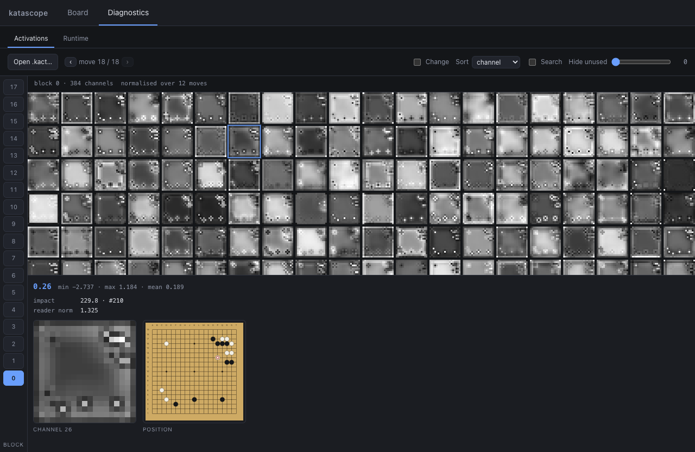
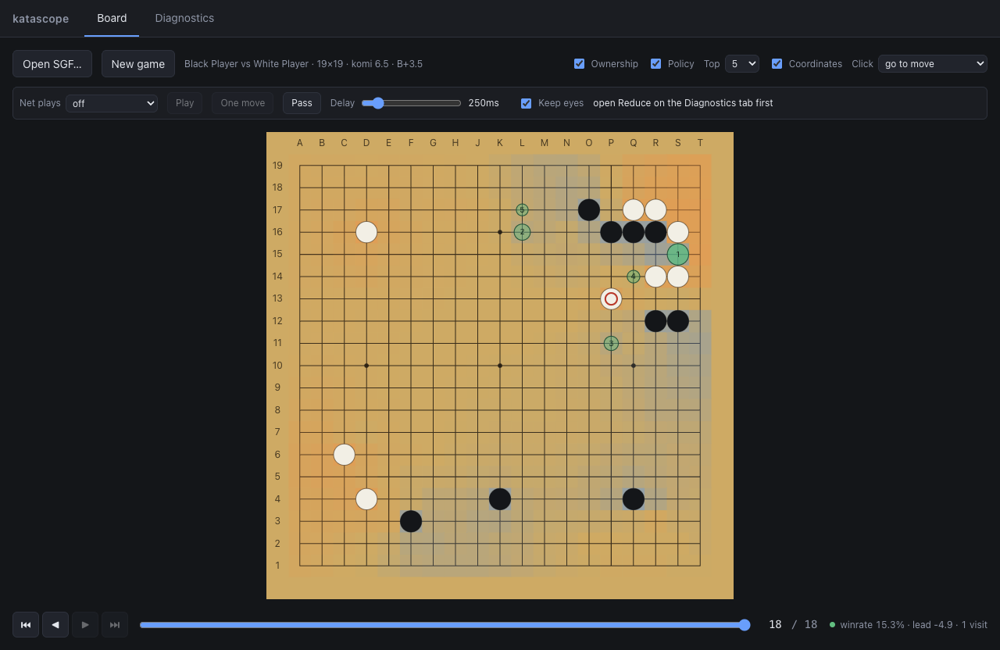

# katascope

A desktop app for inspecting the internals of KataGo neural networks: given a
game and a position, show what the trunk is doing at each residual block.



- **Board** — step through an SGF with KataGo's ownership and policy drawn on
  the board, or play against the network.
- **Diagnostics** — every channel of every residual block as a heatmap. Order
  channels by impact or gradient attribution, see what changed since the last
  move, search for channels that respond to a region of the board, and re-run
  the output heads with channels removed to see what they contribute.



## Quick start

You need Node **>= 22.22.3** (Angular 22's CLI enforces it; `.nvmrc` pins
22.23.1). KataGo, a model file and Python are **not** required — the app ships
with fakes and defaults to them.

```bash
git clone https://github.com/ZBaduk/katascope.git
cd katascope
nvm use          # or otherwise get onto Node >= 22.22.3
npm install
npm run dev
```

That starts Electron with hot reload. Then:

1. Click **Open SGF…** and pick a game — there are samples in
   `packages/core/fixtures/sgf/`.
2. Step through it with the navigator under the board.
3. Switch to **Diagnostics**, pick a block in the left rail, and click a tile to
   enlarge that channel next to the position.

With the fakes, the activations are deterministic noise shaped to look like a
trunk: enough to try every control, and meaning nothing. For real ones, point
the app at KataGo as described next.

## Using a real KataGo

Copy the config and point it at your install:

```bash
cp katascope.config.json katascope.config.local.json
```

```jsonc
{
  "useFakes": false,
  "katagoPath": "/usr/local/bin/katago",
  "modelPath": "/path/to/kata1-b18c384nbt.bin.gz",
  "checkpointPath": "/path/to/kata1-b18c384nbt.ckpt",
  "katagoConfigPath": "configs/analysis-deterministic.cfg",
  "pythonPath": "tools/activation-service/.venv/bin/python",
  "sidecarPath": "tools/activation-service/serve.py"
}
```

`katascope.config.local.json` is gitignored. Relative paths resolve against the
repo root; bare names like `katago` and `python3` are looked up on `PATH`.

**Two model files, not one.** `modelPath` is the `.bin.gz`/`.txt.gz` the C++
engine reads. `checkpointPath` is the `.ckpt` the Python activation service
reads — KataGo's Python code cannot load a `.bin.gz`, and the conversion only
runs the other way. Both must be the same network.

Get a matching pair from [katagotraining.org](https://katagotraining.org): a
network's `model_file` is the `.bin.gz`, and its `model_zip_file` contains the
`.ckpt`. Runs before the PyTorch migration (2020-era, including the original
b6c96 nets) ship a TensorFlow `saved_model` instead and cannot be used.

Then set up the service:

```bash
cd tools/activation-service
python3.12 -m venv .venv
.venv/bin/pip install -r requirements.txt   # includes torch
```

The Diagnostics tab reports whether each subsystem actually came up.

## Capturing activations

```bash
npm run dump -- packages/core/fixtures/sgf/handicap-4.sgf out.kact
npm run dump -- game.sgf out.kact --blocks 0,5,17 --max-moves 50
```

Runs every position of an SGF through the service and writes a `.kact` capture —
float16 on disk, indexed so a reader can seek to a single `(move, block)`.
Handicap and `AB`/`AW` setup stones are carried as setup, never replayed as
moves.

## Other commands

```bash
npm test           # vitest: core, katago-bridge, ui
npm run test:e2e   # builds, then drives the real app with Playwright
npm run typecheck  # every workspace, sources and tests
npm run build      # libraries, renderer, Electron bundles
npm run clean
```

Live-KataGo integration tests are tagged `@katago` and skip unless a binary,
model and analysis config are configured:

```bash
npm run test:katago -w @katascope/katago-bridge
```

The Python service has its own suite:

```bash
cd tools/activation-service
python3.12 -m venv .venv && .venv/bin/pip install -r requirements-dev.txt
.venv/bin/python -m pytest
```

## Layout

```
packages/core             pure TypeScript — domain model, SGF, IPC contract
packages/katago-bridge    Node — spawns KataGo and the Python service
packages/ui               Angular — renderer
apps/desktop              Electron — main process, preload, wiring
tools/activation-service  Python — reads model internals
e2e                       Playwright — drives the built app
```

See [ARCHITECTURE.md](ARCHITECTURE.md) for the module boundaries and data flow,
and [CLAUDE.md](CLAUDE.md) for the conventions.
